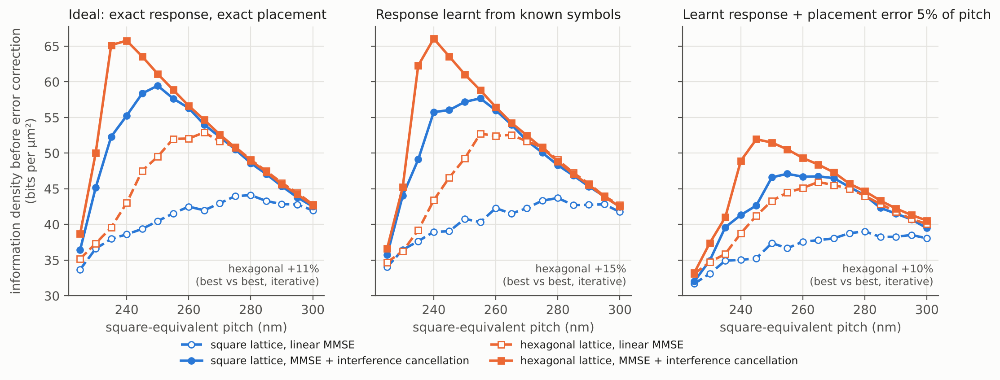
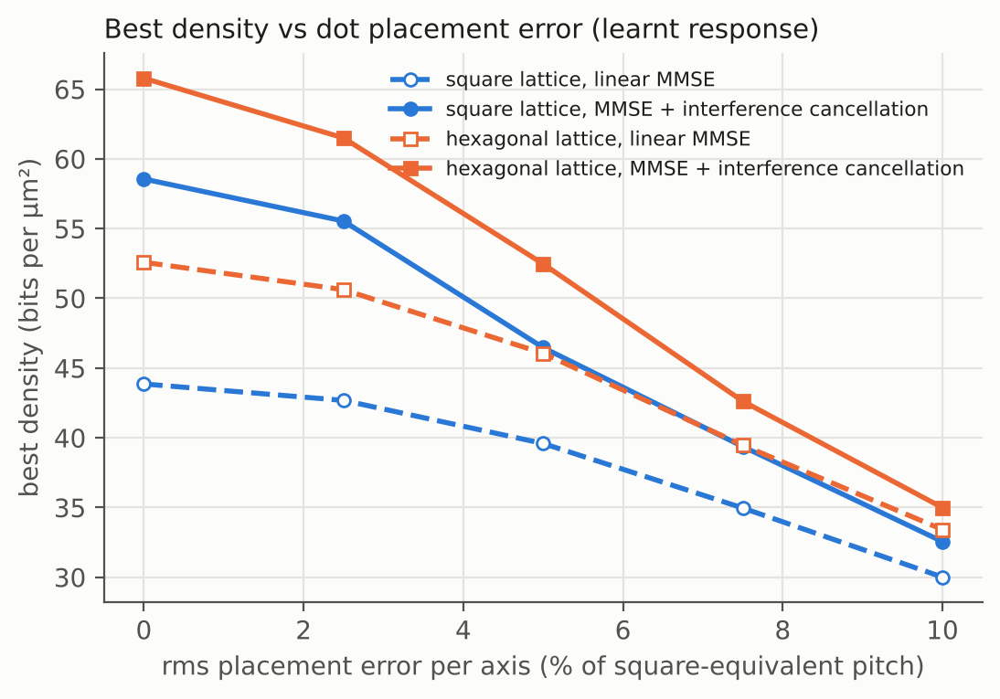
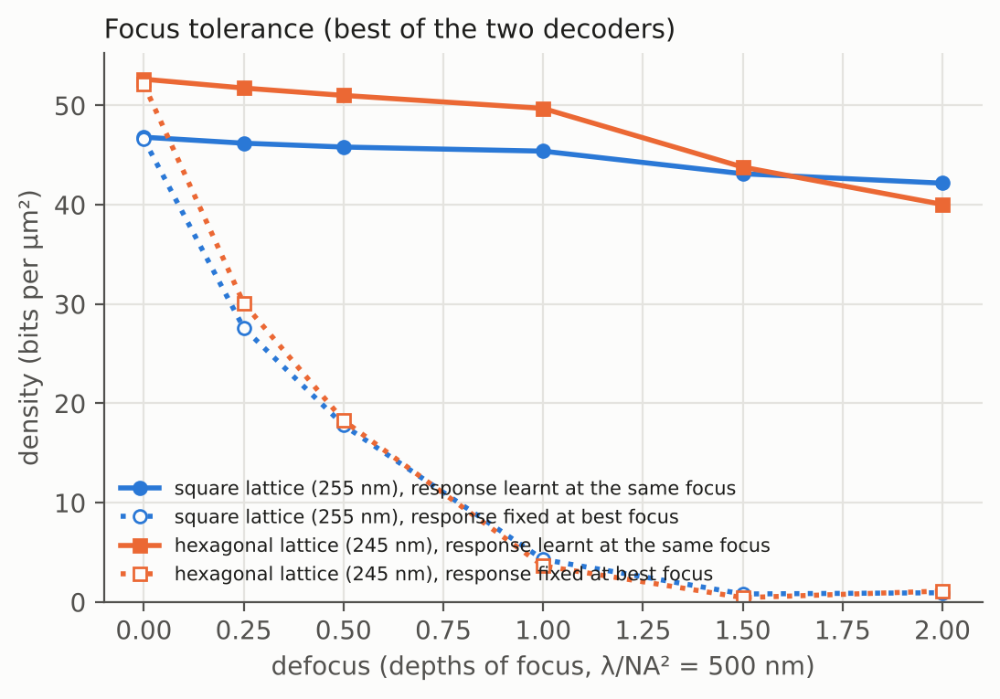

# CUNEUS

[](https://doi.org/10.5281/zenodo.24325753)

**Optics-aware data formats for archival storage in glass: an open simulation study.**

CUNEUS is the successor of [4D-VODS](https://doi.org/10.5281/zenodo.24268721). Its idea is
that the format of an optical storage medium (the lattice of written dots, the alphabet of
each dot and the decoder) should be *computed from the optics of the reader*, the way a
compiler turns a hardware description into machine code, instead of being drawn by hand.

*I am not a professional physicist. CUNEUS grew out of my earlier study 4D-VODS, which started as a geometric intuition (storing data in the shape of engraved symbols); like it, this simulator and its documents were built with the help of AI tools on standard diffraction optics. Corrections from specialists are very welcome.*

> **Status: Phase 1 of 6, simulation only.** Nothing has been written in glass. Every number
> below comes from the simulator in this repository and is checked against `results/` on
> every push.

Project page with a live simulation of the reader and interactive results:
<https://guetthm.github.io/cuneus/> (`index.html`, rebuilt from `results/` by
`python -m cuneus site`).

The concept note (three tiers on one plate, from naked eye to laboratory reader) is
[CUNEUS – Concept Note v0.2](https://claude.ai/artifact/Y9NEWMc7YT3YA7Rg1tzkJP) (working draft). Phase 1
tests its dense tier: amplitude/phase dots (APSK-16) read by a coherent 405 nm, NA 0.90
microscope.

## Phase 1 results



Best information density before error correction, in bits per µm², over square-equivalent
pitches from 225 to 300 nm (`results/lattice.json`, 13,824 symbols per point):

| Condition | Square, linear | Square, iterative | Hexagonal, linear | Hexagonal, iterative |
| --- | --- | --- | --- | --- |
| Ideal: exact response, exact placement | 44.1 | 59.5 | 52.9 | **65.8** |
| Response learnt from known symbols | 43.7 | 57.7 | 52.7 | **66.1** |
| Learnt response + placement error 5% of pitch | 39.0 | 47.1 | 46.0 | **51.9** |

*Linear*: exact linear MMSE equaliser. *Iterative*: the same equaliser followed by parallel
interference cancellation (16 passes). Common setting: periodic lattice of 48 × 48 symbols
with no edges, 10% writing variability, 64,000 photons per symbol.

Independent random draws of the same setting differ by up to about 1 bit/µm²: the realistic
hexagonal case repeated with four further seeds gives 51.9 to 52.7 bits/µm². Differences of
this size, such as 66.1 against 65.8 in the table, are sampling noise: a decoder that learns
the response cannot do better on average than one that knows it exactly.

What Phase 1 found:

1. **The decoder matters more than the lattice.** Interference cancellation raises the best
   hexagonal density from 52.9 to 65.8 bits/µm² (+24%) under ideal conditions.
2. **The hexagonal lattice wins in every case, by less than first estimated.** Its gain over
   the square lattice is +20% with the linear equaliser but +11% with interference
   cancellation, because the iterative decoder recovers part of what the square lattice
   loses to the pupil. The +22% of the concept note is withdrawn. Repeated with four further
   random seeds under realistic conditions, the gain is +10% on average (range 9 to 12%) with
   interference cancellation and +19% (range 18 to 20%) with the linear equaliser
   (`results/seeds.json`).
3. **Learning the optical response is free.** A decoder that learns the response from two
   frames of known symbols (4,608 symbols) does as well as one that knows it exactly, because
   the model uses the known pupil edge and a compact kernel (about 50 effective unknowns).
4. **Dot placement is the main real-world limit.** With placement errors of 5% of the pitch
   (about 12 nm per axis) the best hexagonal density falls from 65.8 to 52.5 bits/µm² in the
   placement run (51.9 in the table above: same setting, other random draws); to
   keep more than 90% of the ideal value the writer must place dots to about 2.5% of the
   pitch, about 6 nm (61.5 bits/µm²).
5. **Re-learning the response turns defocus from a cliff into a slope.** Coherent defocus is
   a pure phase in the pupil, so a decoder that learns the response at the actual focus keeps
   49.7 bits/µm² at one depth of focus (0.5 µm) on the hexagonal lattice, against
   18.3 bits/µm² for a response fixed at best focus at only half a depth of focus. At two
   depths of focus the square lattice overtakes the hexagonal one only because each is
   tested at its own optimum pitch (255 nm against the denser 245 nm).




### Go/no-go of Phase 1

The criterion fixed in the concept note was *"hexagonal gain ≥ 15% over square with estimated
response and 0.05-pitch placement errors"*. With the linear equaliser it is met (+18%); with
the better iterative decoder it is not (+10%). The honest reading is a **conditional go**: the
hexagonal lattice stays the default because it is better in every condition and with every
decoder tested, but CUNEUS's case now rests on three results together (decoder, learnt
response, focus tolerance), not on the lattice alone.

### Compared with 4D-VODS v1.1

4D-VODS v1.1 published 42.6 bits/µm² for APSK-16 dots at 300 nm, with an exact response and
no placement errors. Under the same idealised assumptions CUNEUS reaches 65.8 bits/µm²
(+54%). With a learnt response and 5% placement errors, which v1.1 did not model, it still
reaches 51.9 bits/µm², about 43 bits/µm² of user data with the v1.1 overhead (pilots 1 in 16,
error-correction rate 0.88), about 1.41× a BDXL layer.

## Reproduce

```bash
pip install -r requirements-lock.txt      # exact reference environment (Python 3.13)
python -m cuneus validate                 # physics and numerics checks -> docs/VALIDATION.md
python -m cuneus run all --config configs/phase1.toml   # about 25 min on 2 cores
python -m cuneus figures
python -m cuneus manifest                 # hashes, commands and versions of every result
python -m cuneus check                    # every number in this README vs results/
pytest -q
```

`python -m cuneus run all --quick` runs a small version of every experiment in about a minute.

## What is modelled and what is not

Modelled: scalar coherent imaging through a circular pupil (non-paraxial defocus), square
dots of side 0.6 × pitch with complex writing variability, Gaussian placement errors with
sub-pixel accuracy, complex Gaussian detection noise, a periodic lattice with no edges, a
decoder that learns the response from known symbols.

Not modelled yet: three-dimensional dots and vectorial optics at NA 0.90, non-linear writing
(heat-affected zones), camera pixels and aberrations other than defocus, error-correction
codes (densities are mutual information before error correction), the low-cost and
human-readable tiers (Phases 3–5). The validation checks in
[docs/VALIDATION.md](docs/VALIDATION.md) prove that the code implements its model; only
written glass can show that the model matches reality.

## Repository

| Path | Content |
| --- | --- |
| `cuneus/optics.py`, `lattice.py`, `alphabet.py`, `channel.py` | physical model |
| `cuneus/equalizer.py` | response estimation, linear MMSE, interference cancellation |
| `cuneus/experiments.py` | the five Phase 1 experiments: `lattice`, `placement`, `focus`, `seeds`, `pupil` |
| `cuneus/validation.py` | checks against closed-form optics and exact identities |
| `cuneus/provenance.py`, `claims.py` | hashes of results, published numbers vs results |
| `results/` | result files, `MANIFEST.json` (provenance), `claims.json` (published numbers) |
| `figures/` | PNG, PDF and the plotted values as CSV |
| `docs/PHASE1.md` | Phase 1 report: method, results, limits |
| `index.html`, `cuneus/site.py` | project page; its numbers and chart data come from `results/` |

## Use of AI tools

AI assistants helped write the simulator, the documents and the project page (see the note at
the top). Every result comes from the code in this repository and can be checked by re-running
it: the validation checks compare the code with closed-form optics, and every published number
is checked against the results on every push.

## Contributing

Corrections are the most useful contribution: see [CONTRIBUTING.md](CONTRIBUTING.md) and the
[physics correction](https://github.com/GuettHM/cuneus/issues/new?template=physics_correction.yml)
issue form. Please follow the [code of conduct](CODE_OF_CONDUCT.md).

## Licence and citation

MIT licence. Please cite with the metadata in [CITATION.cff](CITATION.cff). CUNEUS is archived on
Zenodo:

| Version | DOI |
| --- | --- |
| All versions (always resolves to the latest) | https://doi.org/10.5281/zenodo.24325753 |
| 0.1.0 | https://doi.org/10.5281/zenodo.24325754 |
 CUNEUS reuses the
reproducibility infrastructure of 4D-VODS (doi:10.5281/zenodo.24268721).
