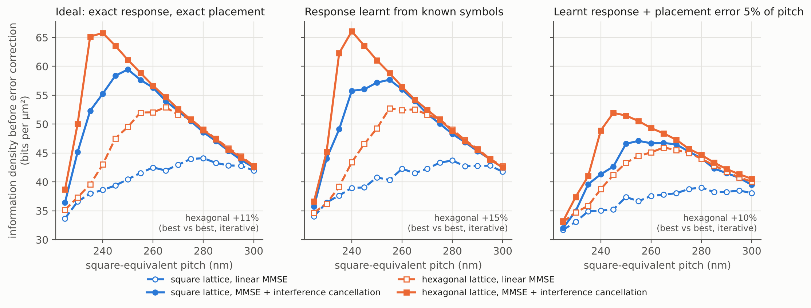
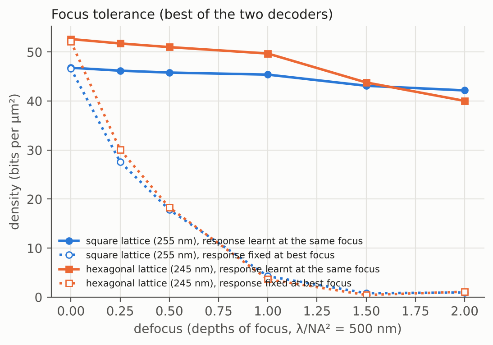

<!-- Markdown source of docs/CUNEUS_Concept_Note_v0.2.pdf, exported from the author's master copy. Edit through an issue or a pull request; see docs/src/README.md. -->

# CUNEUS – Concept Note v0.2

Optics-aware alphabets for archival data storage in glass, from a phone microscope to a laboratory reader (working title)

H. Guettal, 17 November 2026

## 1. At a glance

CUNEUS is a proposed successor to 4D-VODS ([Zenodo](https://doi.org/10.5281/zenodo.24268721), [GitHub](https://github.com/Guett-HM/4d-vods)): one glass plate carrying three tiers of data — text a person can read with a magnifier, a code a low-cost microscope camera can read, and a dense layer for a laboratory reader — whose lattices and alphabets are **computed from the reader's optics instead of drawn by hand**. Phase 1 of the simulator (section 9) found that the dense layer gains most from **a decoder that cancels interference between neighbouring dots and learns the optical response from known symbols**: with realistic dot placement errors it reaches 51.9 bits/µm² before error correction, against 42.6 for 4D-VODS v1.1, and it keeps working one depth of focus away from best focus. A hexagonal lattice adds 10–20% over a square one, depending on the decoder; the 22% first estimated in section 5.1 is withdrawn. The low-cost code needs a focus sweep because it tolerates only ±0.5 depth of focus at its densest pitch.

- **Status:** concept, simulation only; nothing written in glass. Phase 1 (simulator core, tests, validation, provenance) is complete. CUNEUS is a working title (Latin *cuneus*, wedge: the shape that started 4D-VODS and the tool of the first writing system).

- **What is new:** a design rule taken from optics (one symbol per optical degree of freedom, on the lattice that best fits the pupil), an open tool that applies it to any reader, and a bootstrap chain from naked eye to laboratory reader on the same plate.

- **What is reused:** the 4D-VODS simulator, validation checks, provenance and published-number checks.

*I am not a professional physicist. CUNEUS grew out of my earlier study 4D-VODS, which started as a geometric intuition (storing data in the shape of engraved symbols); like it, this concept and its simulator were built with the help of AI tools on standard diffraction optics, and every result can be checked by re-running the code. Corrections from specialists are very welcome.*

## 2. Lessons from 4D-VODS v1.1

Every design choice in CUNEUS answers a measured limit of 4D-VODS v1.1.

| Lesson                                                          | Evidence in 4D-VODS v1.1                                                                                                                                                                                                         | Consequence for CUNEUS                                                                                                                 |
|-----------------------------------------------------------------|----------------------------------------------------------------------------------------------------------------------------------------------------------------------------------------------------------------------------------|----------------------------------------------------------------------------------------------------------------------------------------|
| Shape below the resolution limit does not reach the sensor      | The azimuth of the Voxel-Wedge keeps 20% of its information at 400 nm; the 8-bit wedge only works from 500 nm                                                                                                                    | Data are carried by the field (amplitude, phase, later polarisation); geometry is used only above the resolution limit (finders, text) |
| The decoder and the lattice limit density as much as the optics | At 250 nm the ideal decoder keeps 3.8 bits per symbol, the practical one 2.2                                                                                                                                                     | The lattice and the equaliser are design variables, chosen by calculation                                                              |
| A low-cost reader can align any rotation in focus               | 599 of 600 frames at 1.1 × λ/NA, but defocus was not modelled                                                                                                                                                                    | Defocus is modelled from the start (section 5.3)                                                                                       |
| Honest accounting leaves a small margin                         | Net estimate about 35 bits/µm², 1.15× a BDXL layer                                                                                                                                                                               | A structural gain is needed, not better wording (sections 5.1 and 9)                                                                   |
| Eight phase levels do not fit inside bulk glass at 300 nm       | Voxels 10–38 µm long against a 0.5 µm depth of focus                                                                                                                                                                             | The dense tier is a sealed reflective relief; bulk polarisation voxels are an option, not a claim                                      |
| Small simulated patches flatter joint decoders                  | Checked while preparing this note: the v1.1 decoder at 250 nm gives 33.0 and 34.1 bits/µm² on 15×15 and 19×19 patches against 35.3 on 7×7; at 300 nm the published 42.6 holds (42.2–42.8). Now recorded as erratum E6 of 4D-VODS | CUNEUS simulates periodic lattices with no edges                                                                                       |

## 3. The principle: alphabets designed by the optics

An optical reader can only deliver a fixed number of independent values per unit area, and the alphabet should be designed around that number rather than around a picture of a symbol. For coherent imaging through a circular pupil, the field in the image has this many complex degrees of freedom per unit area:

N_dof = π · (NA / λ)² ≈ 15.5 per µm² (λ = 405 nm, NA = 0.90)

Three rules follow. Sections 5 and 9 test the first two and the decoder of the third; the uneven level spacing will be tested in phase 3:

1.  **Density:** write about one symbol per degree of freedom, i.e. a cell area near 1/N_dof (0.065 µm² here). Denser lattices lose information to the pupil; sparser ones waste area.

2.  **Lattice:** use the lattice whose frequency cell best fits the pupil. The pupil is a disc; the frequency cell of a square lattice is a square, that of a hexagonal lattice a hexagon, which fits a disc more closely, so less of the written information falls outside the pupil.

3.  **Alphabet and decoder:** choose the levels of each symbol (amplitude, phase, later polarisation) to maximise the information that survives noise and writing variability, and decode with an equaliser matched to the linear physics of coherent imaging, with decision feedback. Where noise depends on the level (shot noise grows with brightness, writing errors with the written amplitude), the levels are spaced unevenly so that every pair of neighbouring levels is equally easy to tell apart.

**The format compiler.** CUNEUS turns these rules into an open program that works like a compiler: the input describes the hardware, the output is the storage format. The inputs are the reader (wavelength, NA, coherent or incoherent light, pixel size, noise, focus range) and the writer (smallest feature, number of levels, placement accuracy, variability). The outputs are the lattice and pitch, the alphabet and bit mapping, the decoder, the error-correction rate, and the net density with its margins. Because the format is computed rather than fixed, a measurement that contradicts an assumption does not break the design: if glass shows 22% writing variability instead of 10%, the compiler recomputes lattice, levels and code for the measured value. The same program designs the low-cost layer for a phone microscope and the dense layer for a laboratory reader, and every design it proposes is checked by full simulation.

## 4. Three tiers on one plate

Each tier serves a different reader, and each one explains how to read the next: a mark visible to the naked eye leads to tier 0, tier 0 explains tier 1, and tier 1 carries the index and format of tier 2.

|                  | Tier 0 – human                                              | Tier 1 – low cost (SAMM-2)                                                                                                  | Tier 2 – high density                                                                                                                  |
|------------------|-------------------------------------------------------------|-----------------------------------------------------------------------------------------------------------------------------|----------------------------------------------------------------------------------------------------------------------------------------|
| Reader           | Magnifier or school microscope                              | Bright-field camera, NA 0.1–0.65, LED light, no stage                                                                       | Interferometric microscope, 405 nm, NA 0.90                                                                                            |
| Medium           | Chrome film of a commercial photomask plate on fused silica | The same chrome film; grey levels by the opened area of each cell (two levels first, more once the variability is measured) | Metallised relief on fused silica under a thin inorganic cover, its thickness fixed with the reader's objective                        |
| Lattice          | Lines of text                                               | Hexagonal, pitch set by the designer from λ/NA                                                                              | Hexagonal, nearest neighbours about 263 nm (245 nm square-equivalent pitch, Phase 1 optimum)                                           |
| Alphabet         | Latin letters and pictures                                  | 3–4 grey levels, finders and pilots                                                                                         | APSK-16 (8 phases × 2 reflectances) or the designer's optimum                                                                          |
| Density (target) | About 20,000 characters per cm² (letters about 70 µm tall)  | 0.5–3.8 bits/µm² at 405 nm, as in 4D-VODS v1.1; hexagonal gain to be simulated                                              | 51.9 bits/µm² before error correction with a learnt response and 5% placement errors (Phase 1); about 43 net, about 1.41× a BDXL layer |
| Carries          | How to read the plate, in plain words                       | Specification, decoder description, file index, critical records                                                            | Bulk data                                                                                                                              |

Tier 1 also stands on its own: product marking on glass, sapphire or ceramic, and small archives that must stay readable with cheap equipment. Tier 2 stays a laboratory system; a multilayer version needs partly reflecting layers, and a polarisation-voxel version inside bulk glass is kept as an option that overlaps with Project Silica.

### 4.1 Substrate, film and sealing

A custom-melted glass is not needed. Femtosecond writing changes the refractive index of fused silica by about 10⁻³, and commercial photosensitive glasses such as photo-thermo-refractive glass reach the same order; chalcogenide glasses change more but absorb violet light and cannot be read at 405 nm. A custom melt would add cost and delay without touching the main limit found in Phase 1, the writer's placement accuracy (section 9).

- **Substrate:** fused silica (synthetic quartz), transparent at 405 nm, with low birefringence and good thermal stability. Sapphire only for tier 1 marking on objects read at low NA, because it is birefringent.

- **Film for tiers 0 and 1:** the chrome and chrome-oxide film of commercial photomask plates, deposited industrially with good uniformity. A photomask company can write tiers 0 and 1 directly (phase 5b), so the first real plate does not need a laboratory partner.

- **Tier 2:** a metallised relief under a thin cover. A dry objective at NA 0.90 cannot read through 1–2 mm of glass without strong aberration (Blu-ray uses a 0.1 mm cover at NA 0.85), so the cover thickness is a reader parameter given to the compiler.

- **Sealing:** an index-matched UV adhesive is acceptable for prototypes only, because it is organic; the archival plate needs an inorganic seal, such as direct quartz-to-quartz bonding. Sealing changes the reflectance of the film, so the levels are measured after sealing and given to the compiler.

## 5. First calculations

Three calculations were run with the 4D-VODS simulator for this note. All densities are information recovered before error correction, as in 4D-VODS v1.1.

### 5.1 Hexagonal against square lattice

At the same symbol density, the hexagonal lattice gives the higher density at every pitch up to 300 nm, and its best point is 22% above the best square point with this linear equaliser. Phase 1 (section 9) revises the gain to 10–20%, depending on the decoder. Setting: 405 nm, NA 0.90, coherent readout, APSK-16 dots (side 0.6 × square-equivalent pitch), 10% writing variability, 64,000 photons per symbol, exact linear equaliser; periodic lattice of 48 × 48 symbols with no edges, 18,432 symbols per point.

| Area per symbol (square-equivalent pitch) | Square: density, symbol error | Hexagonal: density, symbol error | Hexagonal nearest neighbours |
|-------------------------------------------|-------------------------------|----------------------------------|------------------------------|
| 0.0625 µm² (250 nm)                       | 40.3 bits/µm², 32.6%          | 48.9 bits/µm², 18.6%             | 269 nm                       |
| 0.0702 µm² (265 nm)                       | 41.6 bits/µm², 22.1%          | **52.8 bits/µm², 4.5%**          | 285 nm                       |
| 0.0756 µm² (275 nm)                       | **43.4 bits/µm², 13.2%**      | 50.9 bits/µm², 2.2%              | 296 nm                       |
| 0.0841 µm² (290 nm)                       | 42.9 bits/µm², 6.4%           | 45.8 bits/µm², 2.1%              | 312 nm                       |
| 0.0900 µm² (300 nm)                       | 42.1 bits/µm², 3.1%           | 42.8 bits/µm², 2.1%              | 322 nm                       |

The reason is the fit between lattice and pupil: at 0.0756 µm² per symbol, 3.9% of the square lattice's frequency cell falls outside the pupil and is lost, against 0.1% for the hexagonal lattice. The best hexagonal cell, 0.070 µm², is close to the one-symbol-per-degree-of-freedom rule (0.065 µm²). As a check, the square lattice at 300 nm gives 42.1 bits/µm², matching the 42.6 published by 4D-VODS v1.1 with a different decoder.

### 5.2 A decoder matched to the physics

Coherent imaging is linear in the written field, so a linear equaliser is the natural decoder. On the same simulated images (19 × 19 symbols, 3,750 scored per point, square lattice):

| Pitch  | 4D-VODS v1.1 decoder         | Linear equaliser | Equaliser + decision feedback |
|--------|------------------------------|------------------|-------------------------------|
| 250 nm | 34.1 bits/µm² (53.8% errors) | 48.2 (19.9%)     | 57.1 (6.8%)                   |
| 275 nm | 46.9 (7.6%)                  | 48.5 (5.2%)      | 50.7 (2.4%)                   |
| 300 nm | 42.8 (2.2%)                  | 43.1 (1.7%)      | 42.9 (2.0%)                   |

At 300 nm all decoders agree, which confirms the v1.1 headline. At 250 nm part of the gain comes from the edge of the finite patch: on the infinite periodic lattice of section 5.1 the linear equaliser gives 40.3 bits/µm². A periodic version of the decision-feedback decoder, combined with the hexagonal lattice, is therefore the first job of the CUNEUS simulator. Both decoders here know the optical response exactly; in practice it must be estimated from the pilots. Phase 1 has done both (section 9).

### 5.3 How much defocus the low-cost code tolerates

The low-cost code survives about half a depth of focus at its densest pitch and one full depth of focus with a 27% larger pitch. Setting: SAMM-24 frames as in 4D-VODS v1.1, NA 0.45 (depth of focus λ/NA² = 2.0 µm), non-paraxial defocus, decoder unaware of the defocus, 40 randomly rotated frames per point.

| Defocus                   | Pitch 1.1 × λ/NA: aligned, symbol error | Pitch 1.4 × λ/NA: aligned, symbol error |
|---------------------------|-----------------------------------------|-----------------------------------------|
| 0                         | 40/40, 0.01%                            | 40/40, 0.01%                            |
| 0.5 depth of focus (1 µm) | 40/40, 0.14%                            | 40/40, 0.02%                            |
| 1.0 depth of focus (2 µm) | 34/40, 14.8%                            | 39/40, 1.3%                             |
| 1.5 depth of focus (3 µm) | 3/40, 59%                               | 7/40, 42%                               |
| 2.0 depth of focus (4 µm) | 0/40                                    | 0/40                                    |

A reader without a focus stage must therefore take a short focus sweep (5–10 images about half a depth of focus apart) and decode the sharpest, or estimate the defocus from the finders and correct for it. SAMM-2 will include both, and the designer tool will trade pitch against focus range.

## 6. What is new and what is prior art

None of the ingredients is new on its own; the candidate contribution is combining them into one open, reproducible design method and one plate readable from naked eye to laboratory. Phase 1 has already shown that its three main results (the hexagonal gain with 2D equalisation, interference cancellation, and defocus recovery from a measured complex field) rest on known techniques. The candidate contributions left for the phase 2 search are the open format compiler, the self-aligning code scaled to λ/NA for readers without a stage, and the three-tier plate.

| Ingredient                                                          | Known from                                                                                                                                                                                                                                                                                                                                            | What CUNEUS adds                                                                                                                                |
|---------------------------------------------------------------------|-------------------------------------------------------------------------------------------------------------------------------------------------------------------------------------------------------------------------------------------------------------------------------------------------------------------------------------------------------|-------------------------------------------------------------------------------------------------------------------------------------------------|
| Hexagonal sampling of circularly band-limited signals               | Petersen and Middleton (1962)                                                                                                                                                                                                                                                                                                                         | Applied as a design rule to multi-level coherent storage and to camera-read codes, with a quantified, reproducible comparison                   |
| Hexagonal lattices in optical storage                               | TwoDOS project (Philips Research and university partners): hexagonal bit lattice and 2D detection (Immink et al., IEEE GLOBECOM 2003); 2D partial-response channel with a nonlinear equaliser on a hexagonal lattice (Conway, IEEE Trans. Consumer Electronics 50, 2004); 2D MMSE equaliser (Huang, Mathew and Chong, IEEE Trans. Magnetics 41, 2005) | Multi-level phase and amplitude symbols, coherent readout and a learnt response. The hexagonal gain and the 2D equaliser themselves are not new |
| Numerical refocusing of a measured complex field                    | Digital holographic microscopy, e.g. Colomb et al., Optics Letters 35, 1840 (2010)                                                                                                                                                                                                                                                                    | Used inside the decoder (a response learnt at the actual focus). Not new as optics                                                              |
| Interference cancellation and channel estimation from known symbols | Multi-user detection and pilot-based channel estimation in digital communications                                                                                                                                                                                                                                                                     | Applied to a coherent optical storage channel. Not new as signal processing                                                                     |
| Degrees of freedom of an optical image                              | Gabor; Toraldo di Francia (1969)                                                                                                                                                                                                                                                                                                                      | Used to set the symbol density of the alphabet                                                                                                  |
| Machine-designed symbol encodings and learned decoders              | Microsoft Project Silica                                                                                                                                                                                                                                                                                                                              | An open tool that designs lattice, alphabet and code for any reader, with physics validation                                                    |
| 2D codes with finder patterns                                       | QR, Data Matrix, Aztec                                                                                                                                                                                                                                                                                                                                | Multi-level, scaled to λ/NA, tolerant to defocus, compared head-to-head with a binary code                                                      |
| Human-readable archival layers                                      | Long Now Foundation's Rosetta Disk, microfilm                                                                                                                                                                                                                                                                                                         | A bootstrap chain on the same plate, from visible mark to text to machine code                                                                  |

## 7. Risks and limits

The largest risk is unchanged from 4D-VODS: every number here is simulated, and real writing may not be as clean, as linear or as well placed as the model assumes.

- **Placement:** the largest loss found in Phase 1. Placement errors of 5% of the pitch (about 12 nm per axis) cut the best density by about 20%, from 65.8 to about 52 bits/µm²; about 6 nm keeps more than 90% of it. The writer's placement accuracy is the first specification to check with a partner laboratory. Real writers' errors are partly slow and systematic (stage drift, temperature), which pilots can track; phase 3 will test a decoder that does so.

- **Linearity:** heat-affected zones and neighbouring pulses can make writing non-linear; the equaliser then needs a channel estimated from pilots, or a learned decoder.

- **Reader complexity:** tier 2 still needs an interferometric laboratory reader; CUNEUS improves its density, not its cost.

- **Defocus and optics:** the low-cost tier needs a focus sweep; lens distortion, colour sensors and image compression are not yet modelled.

- **Durability:** the chrome film of tiers 0 and 1 sits on the surface and must be sealed; an organic adhesive is acceptable for prototypes only, and the archival plate needs an inorganic seal (section 4.1).

- **Novelty:** most ingredients are known (section 6); the contribution may turn out to be the open method and the comparison, not a new physical effect.

- **Simulation only:** as for 4D-VODS, the validation checks prove the code implements its model, not that the model matches glass.

## 8. Plan, tests and go/no-go criteria

CUNEUS would start as a new repository that reuses the 4D-VODS infrastructure (provenance, published-number checks, validation, continuous integration), and each phase ends with a measurable go/no-go criterion.

| Phase | Work                                                                                                                                                                                                                                                                                          | Go/no-go criterion                                                                                                                                                                              |
|-------|-----------------------------------------------------------------------------------------------------------------------------------------------------------------------------------------------------------------------------------------------------------------------------------------------|-------------------------------------------------------------------------------------------------------------------------------------------------------------------------------------------------|
| 0     | This concept note                                                                                                                                                                                                                                                                             | Approved by the author; scope fixed                                                                                                                                                             |
| 1     | Simulator core: periodic square and hexagonal lattices, equaliser with decision feedback, optical response estimated from pilots, placement errors, defocus                                                                                                                                   | Hexagonal gain ≥ 15% over square with estimated response and 0.05-pitch placement errors. Done: +18% with the linear equaliser, +10% with interference cancellation; conditional go (section 9) |
| 2     | Literature and patent search on the six rows of section 6                                                                                                                                                                                                                                     | At least one contribution not anticipated                                                                                                                                                       |
| 3     | Designer tool: reader and writer in, lattice, alphabet, code and net density out; decoder that tracks slow, systematic placement errors with the pilots                                                                                                                                       | Predictions within 5% of full simulation on 4D-VODS v1.1 cases and this note                                                                                                                    |
| 4     | SAMM-2: hexagonal grey-level code with focus sweep, compared head-to-head with a binary Data-Matrix-like code                                                                                                                                                                                 | ≥ 20% more net density than the binary code at equal reliability                                                                                                                                |
| 5     | Paper experiment: tiers 0 and 1 printed large and photographed through a pinhole, which reproduces the scaled optics                                                                                                                                                                          | ≥ 95% of real frames decoded                                                                                                                                                                    |
| 5b    | First real plate without a laboratory: a commercial chrome-on-quartz photomask (quotes seen around 500 USD for a 5-inch plate) carrying tier 0 text and tier 1 test frames, read with a low-cost microscope and a phone; two levels first, grey levels after measuring the mask's variability | ≥ 95% of frames decoded; measured level variability fed to the compiler                                                                                                                         |
| 6     | Glass with a partner laboratory: tier 2 test grids that measure placement error and writing variability first, then data                                                                                                                                                                      | Measured writing variability and symbol error within twice the simulated values; measured placement error fed to the compiler                                                                   |

Phases 1, 3 and 4 need only software and can be done here; phase 5 needs a printer, a pin-hole and a phone; phase 5b needs a commercial photomask; phase 6 needs a laboratory partner.

## 9. Phase 1 results

*Done on 17 November 2026 in a new repository, CUNEUS 0.1.0 ([GitHub](https://github.com/Guett-HM/cuneus); [Zenodo, doi:10.5281/zenodo.24325753](https://doi.org/10.5281/zenodo.24325753)), which reuses the 4D-VODS infrastructure: 12 validation checks against closed-form optics, a provenance hash for every result file, and every published number checked against the results on every run. The full report is [docs/PHASE1.md](../PHASE1.md) in the repository.*

Setting as in section 5.1 (405 nm, NA 0.90, coherent readout, APSK-16 dots, 10% writing variability, 64,000 photons per symbol, periodic lattice of 48 × 48 symbols with no edges), with 13,824 symbols per point and pitches from 225 to 300 nm. Two decoders: the exact linear equaliser, and the same followed by interference cancellation, which subtracts the image of the decided neighbours and re-decides each dot. Three conditions: ideal; optical response learnt from two frames of known symbols; learnt response plus dot placement errors of 5% of the pitch.

| Best density, bits/µm² before error correction | Square, linear | Square, cancellation | Hexagonal, linear | Hexagonal, cancellation |
|------------------------------------------------|----------------|----------------------|-------------------|-------------------------|
| Ideal                                          | 44.1           | 59.5                 | 52.9              | 65.8                    |
| Learnt response                                | 43.7           | 57.7                 | 52.7              | 66.1                    |
| Learnt response and 5% placement error         | 39.0           | 47.1                 | 46.0              | **51.9**                |

Independent random draws of the same setting differ by up to about 1 bit/µm²: the realistic hexagonal case repeated with four further seeds gives 51.9 to 52.7, and the placement experiment gives 52.5 for the same setting. Differences of this size, such as 66.1 against 65.8 in the table, are sampling noise: a decoder that learns the response cannot do better on average than one that knows it exactly.

1.  **The decoder matters more than the lattice.** Interference cancellation lifts the hexagonal lattice from 52.9 to 65.8 bits/µm² (+24%) in ideal conditions. The technique itself is standard in digital communications (section 6).

2.  **The hexagonal lattice always wins, by less than first estimated.** Ideal: +20% with the linear equaliser, +11% with cancellation. Realistic, over four further random seeds: +10% on average (range 9 to 12%) with cancellation, +19% (18 to 20%) with the linear equaliser. The reason is geometric: at 265 nm, 6.1% of the square lattice's frequency cell lies outside the pupil and is never seen, against 1.1% for the hexagonal one. A decoder that uses the finite alphabet recovers part of what is lost, so the advantage shrinks. Hexagonal lattices with 2D equalisation were already studied for TwoDOS in 2003–2005 (section 6).

3.  **Learning the response costs nothing measurable**, provided the model uses the known pupil edge and a compact kernel (about 50 effective unknowns). An unconstrained estimate was 16–26% wrong and made cancellation diverge.

4.  **Dot placement is the largest real-world loss.** Errors of 5% of the pitch (about 12 nm per axis) cost 20% of the density; about 6 nm keeps more than 90%.

5.  **Defocus becomes a slope instead of a cliff.** Coherent defocus is a pure phase in the pupil, so a decoder that learns the response at the actual focus keeps 49.7 bits/µm² at one depth of focus (0.5 µm), while a response fixed at best focus falls to 18.3 at half a depth of focus. Recovering focus from a measured complex field is known from digital holographic microscopy (section 6). At two depths of focus the square lattice (42.2) overtakes the hexagonal one (40.0) only because each is tested at its own optimum pitch, 255 nm for the square and the denser 245 nm for the hexagonal lattice. The known symbols must then be spread over the plate as pilots; Phase 3 will size that overhead.

**Go/no-go: conditional go.** The criterion of section 8 is met with the linear equaliser (+18%) and missed with interference cancellation (+10%). The hexagonal lattice stays the default because it is better in every condition, with both decoders and in every seed, but the case for CUNEUS now rests on three results together: interference cancellation, a learnt response and the focus tolerance it brings. Against 4D-VODS v1.1 (42.6 bits/µm² at 300 nm with an exact response and no placement errors), CUNEUS reaches 65.8 bits/µm² under the same idealised assumptions (+54%), and 51.9 with a learnt response and placement errors that v1.1 did not model: about 43 bits/µm² of user data with the v1.1 overhead, about 1.41× a BDXL layer.

**What changed in this note (v0.2):** the 22% hexagonal gain is withdrawn (sections 1 and 5.1); the tier 2 spacing and density come from Phase 1 (section 4); the placement risk is quantified (section 7); the Phase 1 criterion carries its result (section 8); substrate, film and sealing are specified (section 4.1); phase 5b and a decoder that tracks placement errors are added to the plan (section 8).

**Next step:** Phase 2, the literature and patent search of section 6, now with interference cancellation and response learning on the list.
